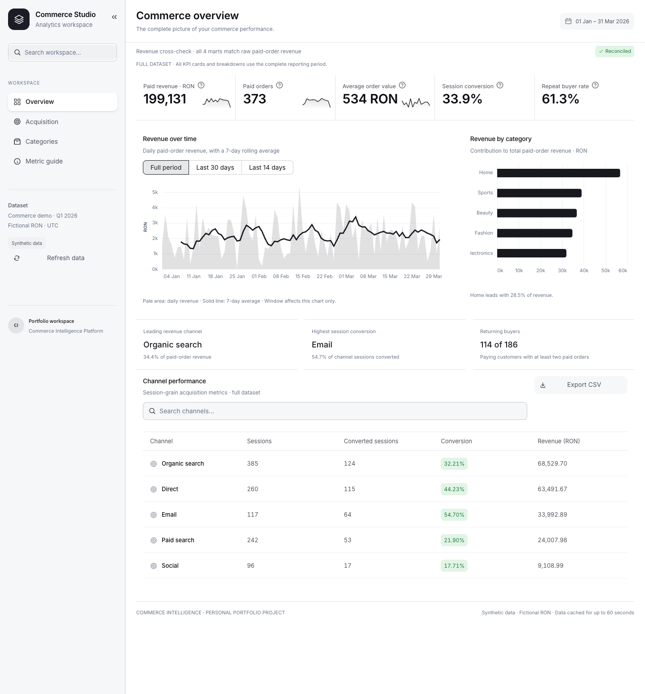
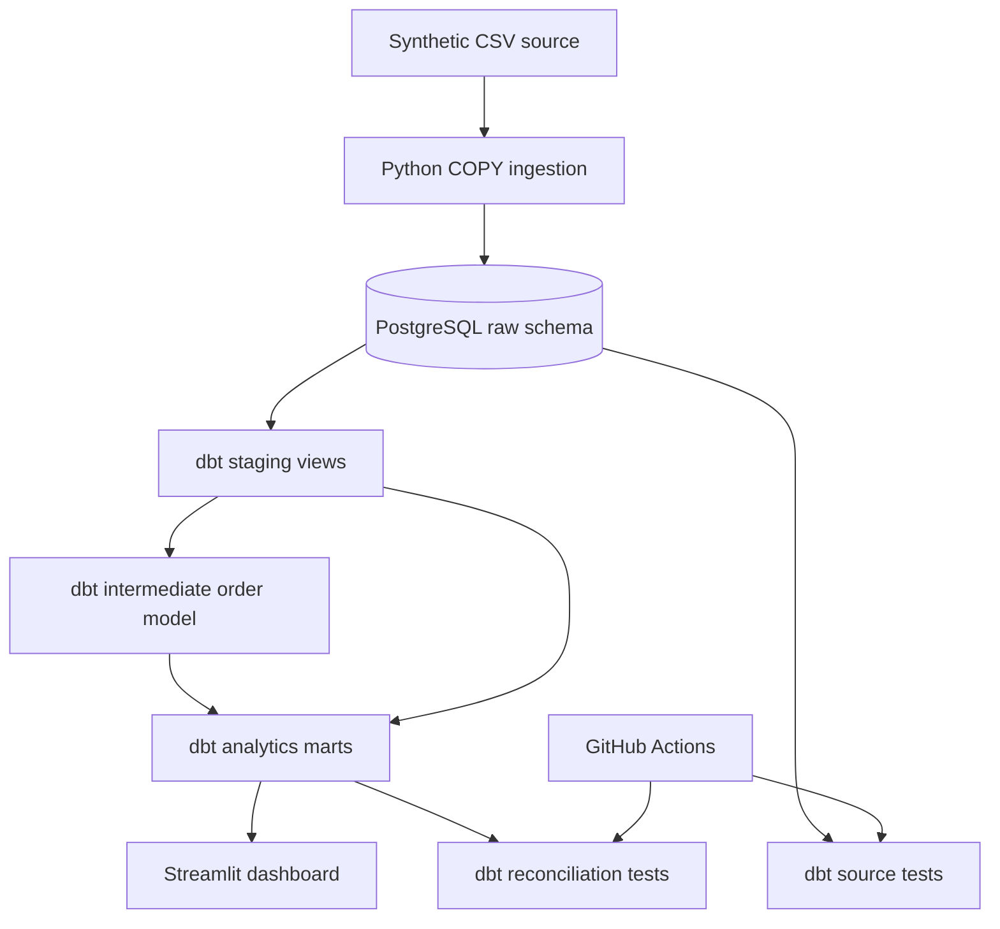

# Commerce Intelligence Platform

**Portfolio project · Analytics Engineering · Synthetic data only**

[](https://github.com/dutuvalentin16-dev/commerce-intelligence/actions/workflows/ci.yml)

Local end-to-end verification completed on 2026-11-11: **10 dbt models, 32 dbt data
tests and 10 Python tests passed** on PostgreSQL 16 / Python 3.11. CSV-to-mart
reconciliation and the dashboard's five displayed KPIs were verified. GitHub Actions
also passed on Ubuntu / Python 3.11: [verified CI run](https://github.com/dutuvalentin16-dev/commerce-intelligence/actions/workflows/ci.yml).
[Live demo](https://dutuvalentin16-dev.github.io/commerce-intelligence/) · [Source code](https://github.com/dutuvalentin16-dev/commerce-intelligence)
Read the [case study](docs/case-study.md), [model contracts](docs/data-model.md),
[10-minute demo](docs/demo-guide.md).

An end-to-end ecommerce analytics pipeline built to demonstrate the skills required for a junior Data Analytics / Analytics Engineer role: Python ingestion, PostgreSQL, SQL, dbt staging and aggregate transformations, automated data tests, GitHub Actions and a Streamlit dashboard.

> **Important:** This is a learning/portfolio project, NOT production experience, NOT real business performance, and not affiliated with any employer. All customer/order/session data are synthetic. Monetary values use fictional RON.

## Online demo and local application

**[Open the interactive demo](https://dutuvalentin16-dev.github.io/commerce-intelligence/)** — no account required.
The demo publishes only synthetic reporting aggregates. On every push to main, CI
rebuilds the pipeline and publishes a fresh snapshot only after all validations pass.
The main Python/Streamlit application remains available through the local quickstart.

## Reporting workspace



Four views cover the overview, acquisition, category economics and metric definitions.
A light monochrome interface uses local SVG icons, a persistent collapsible icon rail,
semantic HTML tables and data-driven weekly sparklines.
Charts include hover details and a selectable trend window; channel/category tables can
be exported as CSV. A read-time revenue cross-check compares all four marts with raw
paid-order revenue. The trend window affects its chart only; KPI cards and breakdowns
always cover the full displayed dataset period.

More screenshots: [acquisition](docs/images/dashboard-acquisition.png) ·
[categories](docs/images/dashboard-categories.png) ·
[icon rail](docs/images/dashboard-icon-rail.png).

## Problem and solution

An ecommerce company wants consistent answers to these business questions:

1. What are daily paid-order revenue and average order value (AOV)?
2. Which categories and channels drive recognized revenue?
3. What is conversion rate by acquisition channel, defined as *sessions with at least one paid order / sessions*?
4. How many paying customers placed 2 or more paid orders?
5. Are order revenue totals identical in the channel and daily marts?

The pipeline is intentionally designed to expose **data grain, quality, lineage and revenue semantics**, not just visual charts.

## Architecture



- **Source grain:** one row/customer, product, session, order or order item.
- **Transformations:** staging models, order-level enrichment, daily/channel/category/repeat-customer marts.
- **Checks:** unique and not-null IDs, relational consistency, acceptable statuses, revenue reconciliation and conversion-rate bounds.
- **Idempotence:** re-ingesting the same CSV set replaces raw tables atomically in a single PostgreSQL transaction.
- **Limitations:** simple offline batch processing, no external API yet, no scheduling yet, no production secrets handling or end-user authentication.

## Quickstart (Windows, Mac or Linux)

Requires **Docker Desktop**, **Python 3.11+**, a terminal and Git. The shell examples work in Bash / macOS / Linux; Windows users may use PowerShell (virtual-environment activation command differs).

```bash
# 1. Open terminal in project directory
python -m venv .venv
source .venv/bin/activate
# Windows PowerShell: .venv\\Scripts\\Activate.ps1
pip install -r requirements-lock.txt

# 2. Start local PostgreSQL at localhost:5434
docker compose up -d --wait postgres

# 3. Create deterministic fake ecommerce data and load it
python -m commerce_pipeline.generate_sample_data
python -m commerce_pipeline.ingest

# 4. Run SQL models AND data tests
dbt build --profiles-dir .
python -m commerce_pipeline.verify_metrics

# 5. See dashboard
streamlit run dashboard/app.py
```

A PostgreSQL container can need several seconds to become healthy; if the ingestion connection fails immediately, check `docker compose ps` and rerun it after the health check reports healthy.

To run Python unit tests:

```bash
python -m pytest -q
```

To also test PostgreSQL ingestion reruns and transactional rollback:

```bash
COMMERCE_INTEGRATION_TESTS=1 python -m pytest -q
```

After generating the default dataset, ingestion and `dbt build`, also verify the
dashboard's four views and that trend controls preserve the full-period KPI values:

```bash
COMMERCE_INTEGRATION_TESTS=1 COMMERCE_DASHBOARD_TESTS=1 python -m pytest -q
```

These integration tests create and drop isolated `commerce_test_*` databases, so the
local database user needs database creation permission (provided by the demo container).
The default test run skips them. Run against the local demo PostgreSQL instance.

`requirements-lock.txt` pins the full environment validated on macOS Apple silicon /
Python 3.11 and validated by Linux CI. The dependency ranges remain in
`requirements*.txt`. Neither Python nor dbt automatically loads `.env`; export custom
`PG*` values in your shell when overriding the documented local defaults.


Stop PostgreSQL with `docker compose down` (preserves its named data volume).

## One-command demo

After installing dependencies and activating Python 3.11:

```bash
make demo       # start database, generate, ingest, build, reconcile, test
make dashboard  # open the reporting workspace on localhost:8501
```

The repository and demo are public. The online demo is a read-only snapshot exported
from verified PostgreSQL/dbt marts, not a live database service. The complete Streamlit
application runs locally using the Docker quickstart.

## Sample data and finance definitions

- Generated with `random.Random(seed)`; deterministic and publicly safe to show.
- **Recognized revenue:** order item quantity × unit price, only where order status is `paid`. Cancelled and refunded orders contribute zero. This is a simplified illustrative rule, **not a complete accounting policy**.
- **Conversion rate:** fraction of sessions with one or more paid orders, NOT paid orders divided by sessions.
- **AOV:** total recognized revenue divided by the number of paid orders.
- **Product margin:** paid product sales minus synthetic product cost; excludes shipping, returns costs, taxes, operational costs, CAC and platform commissions.
- **Repeat customers:** customers with at least 2 paid orders in the generated period.
- Event dates use UTC explicitly to prevent local timezone surprises.

The generator ensures a single order at most per session in its sample data, but the channel SQL uses session-grain pre-aggregation to avoid duplicate-session conversion counts if sources evolve.

## Repository walkthrough

| Folder | Purpose |
|---|---|
| `commerce_pipeline/generate_sample_data.py` | Reproducible synthetic dataset generator |
| `commerce_pipeline/ingest.py` | Transactional CSV → PostgreSQL using COPY |
| `sql/create_raw_tables.sql` | Keys, relationships, checks on source data |
| `models/staging/` | Raw source normalization |
| `models/intermediate/` | Order-grain enrichments |
| `models/marts/` | Metrics for consumers (daily, category, channel, retention) |
| `tests/` | Python unit tests + dbt reconciliation and grain tests |
| `dashboard/` | Reporting workspace, semantic HTML tables and local SVG primitives |
| `docs/` | Architecture choices, interviews, next implementation steps |
| `.github/workflows/ci.yml` | Automated unit tests and dbt build in CI |

## Current scope and next iteration

This version is a verified personal portfolio demo: full batch ingestion, tested dbt
reporting, independent metric reconciliation, a reporting UI and automated CI. It can
be explored through the public demo and reproduced locally using the documented setup.

The next engineering milestones are dimensional facts/dimensions, a licensed public
source, incremental loading with update semantics, and persisted run monitoring. API
integration, Dagster, cohort analysis and anomaly detection remain future work. None
of these capabilities is claimed by the current demo.

A passing pipeline demonstrates implementation. The author should also practice the
[walkthrough](docs/demo-guide.md) and explain the modeling and testing decisions.

## Development approach

This personal project was developed with AI assistance. Metric contracts, independent
source reconciliation, automated tests and CI provide inspectable implementation evidence.

## Security and privacy

Development-only database credentials are committed in Docker Compose for easy local setup; **never reuse them in production**. Do not commit `.env`, real client or employer data, API tokens, or production credentials.
